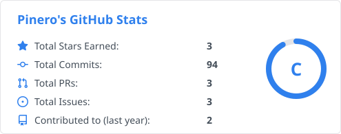

<!--
  主页 README · 皮内罗 / Pinero
  蛇的颜色：.github/workflows/snake.yml 里的 color_snake
  数据卡：scripts/gen-stats.mjs 自己算、自己画，颜色在 THEMES 里改
-->

<h1>你好，我是皮内罗 👋</h1>

<strong>Pinero</strong> · 把日常琐事做成顺手的小工具

  
  

---

### 🧩 我做的东西

- [**Matepaper · 麻纸**](https://github.com/2310770803/Matepaper) `Electron` `React` `TypeScript` — 本地优先的 Windows 桌面个人工具箱：便签、备忘录、待办、日子记录、阅读记录、习惯追踪、收支记录和密码本，数据只存在自己电脑上。
- [**dsh-session-copy**](https://github.com/2310770803/dsh-session-copy) `DSH 插件` — 会话标题栏一键复制：深链、整段对话 Markdown、勾选的消息，或者工作目录。
- [**dsh-session-rewind**](https://github.com/2310770803/dsh-session-rewind) `DSH 插件` — 每条用户消息旁的回退按钮：撤回这条消息和它之后的上下文，原文放回输入框接着改。
- [**quota-pulse**](https://github.com/2310770803/quota-pulse) `Electron` — 盯住 AI 编程工具的 Token 用量和额度，别等断流了才发现。

### 🔭 最近在折腾

- 把 **Matepaper** 继续往前推：更快的全局捕获、更顺的 Markdown 导入
- 给 **DSH** 写顺手的小插件：复制、回退，以及下一个还没想好的

### 🛠️ 技术栈

##### 语言 · 前端

<picture>
  <source media="(prefers-color-scheme: dark)" srcset="assets/stats/stats-dark.svg" />
  
</picture>

<code></code>
<code></code>
<code></code>
<code></code>
<code></code>

##### 桌面 · 构建

<code></code>
<code></code>
<code></code>

##### 工具

<code></code>
<code></code>
<code></code>

---

  <picture>
    <source media="(prefers-color-scheme: dark)" srcset="assets/snake/snake-dark.svg" />
    
  </picture>

---

  数据留在本地，工具应该随叫随到 · <a href="https://github.com/2310770803/Matepaper">Matepaper</a> · <a href="https://github.com/2310770803/dsh-session-copy">dsh-session-copy</a> · <a href="https://github.com/2310770803/dsh-session-rewind">dsh-session-rewind</a>

